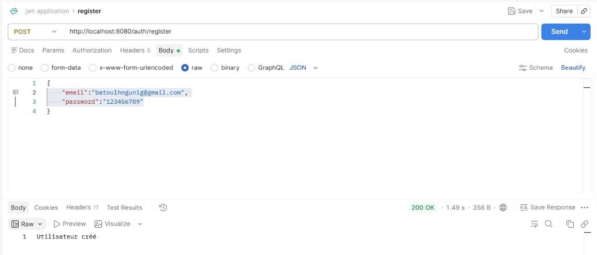
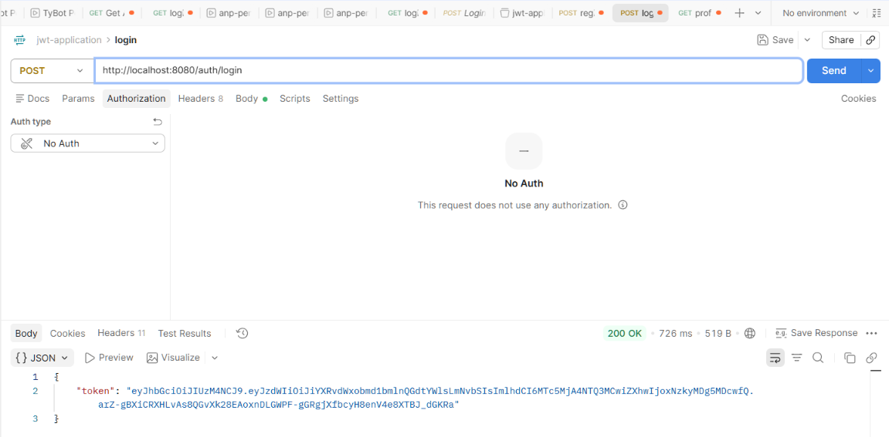
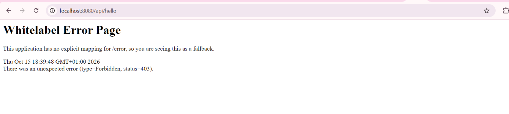
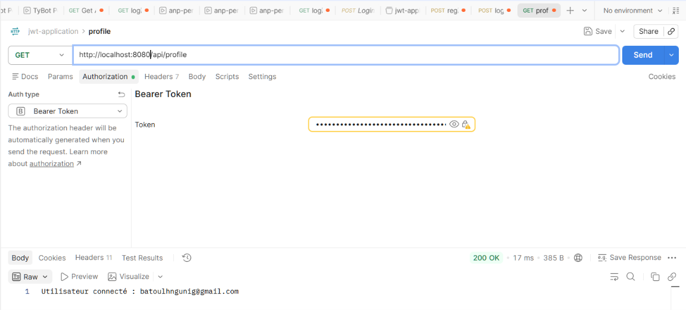

# 🔐 JWT Demo : Authentification stateless avec Spring Boot & Spring Security

Projet de démonstration d'une **API REST sécurisée par JSON Web Token (JWT)** avec Spring Boot, Spring Security, Spring Data JPA et une base H2 en mémoire.

L'utilisateur s'inscrit, se connecte, reçoit un token signé, puis l'envoie dans l'en-tête `Authorization` pour accéder aux endpoints protégés. Aucune session HTTP n'est utilisée côté serveur.

---

## 📑 Table des matières

1. [Fonctionnalités](#-fonctionnalités)
2. [Technologies utilisées](#-technologies-utilisées)
3. [Rappel : qu'est-ce qu'un JWT ?](#-rappel--quest-ce-quun-jwt-)
4. [Architecture du projet](#-architecture-du-projet)
5. [Flux d'authentification](#-flux-dauthentification)
6. [Prérequis](#-prérequis)
7. [Installation et lancement](#-installation-et-lancement)
8. [Configuration](#-configuration)
9. [Documentation de l'API](#-documentation-de-lapi)
10. [Tests avec curl et Postman](#-tests-avec-curl-et-postman)
11. [Description détaillée des composants](#-description-détaillée-des-composants)
12. [Sécurité : limites et améliorations](#-sécurité--limites-et-améliorations)
13. [Dépannage](#-dépannage)
14. [Pistes d'évolution](#-pistes-dévolution)
15. [Auteur et licence](#-auteur-et-licence)

---

## ✨ Fonctionnalités

- Inscription d'un utilisateur (`/auth/register`) avec **mot de passe haché en BCrypt**
- Connexion (`/auth/login`) et **génération d'un token JWT signé (HMAC-SHA)**
- Protection des endpoints `/api/**` par un **filtre JWT personnalisé**
- Architecture **stateless** (pas de session, CSRF désactivé)
- Base de données **H2 en mémoire** avec console web pour le débogage
- Utilisation de **records Java** pour les DTO

---

## 🛠 Technologies utilisées

| Technologie | Rôle |
|---|---|
| Java 17+ | Langage (records, `var`, etc.) |
| Spring Boot 3.x | Framework applicatif |
| Spring Web | API REST |
| Spring Security | Authentification et autorisation |
| Spring Data JPA / Hibernate | Persistance |
| H2 Database | Base en mémoire pour la démo |
| jjwt 0.13.0 | Création et validation des JWT |
| Maven | Gestion des dépendances et build |

---

## 📘 Rappel : qu'est-ce qu'un JWT ?

Un **JSON Web Token** est une chaîne compacte composée de trois parties encodées en Base64URL et séparées par des points :

```
HEADER.PAYLOAD.SIGNATURE
```

| Partie | Contenu | Exemple |
|---|---|---|
| **Header** | Algorithme de signature et type | `{"alg":"HS256"}` |
| **Payload (claims)** | Données : `sub` (utilisateur), `iat` (émission), `exp` (expiration) | `{"sub":"ali@mail.com","iat":...,"exp":...}` |
| **Signature** | HMAC du header et du payload avec la clé secrète | Garantit l'intégrité |

> ⚠️ Le payload est **encodé, pas chiffré** : ne jamais y placer d'informations sensibles (mot de passe, etc.). La signature garantit seulement que le token n'a pas été modifié.

---

## 🗂 Architecture du projet

```
ma.enset.jwtdemo
├── config
│   └── SecurityConfig.java            # Configuration Spring Security
├── controller
│   ├── AuthController.java            # /auth/register et /auth/login
│   └── UserController.java            # /api/hello et /api/profile (protégés)
├── dto
│   ├── AuthResponse.java              # record (String token)
│   ├── LoginRequest.java              # record (String email, String password)
│   └── RegisterRequest.java           # record (String email, String password)
├── entity
│   └── AppUser.java                   # Entité JPA (table "users")
├── repository
│   └── UserRepository.java            # Interface JpaRepository
├── security
│   ├── JwtFilter.java                 # Filtre exécuté à chaque requête
│   └── JwtService.java                # Génération et validation des tokens
├── service
│   └── CustomUserDetailsService.java  # Charge l'utilisateur depuis la base
└── JwtDemoApplication.java            # Point d'entrée
```

L'organisation suit une séparation par responsabilité (configuration, contrôleurs, DTO, entités, accès aux données, sécurité, services).

---

## 🔄 Flux d'authentification

### 1. Inscription

```
Client ──POST /auth/register {email, password}──▶ AuthController
                                                   │ email déjà pris ? → 400
                                                   │ hash BCrypt du mot de passe
                                                   │ rôle = "USER"
                                                   ▼
                                              UserRepository.save()
Client ◀──────────── 200 "Utilisateur créé" ───────┘
```

### 2. Connexion

```
Client ──POST /auth/login {email, password}──▶ AuthController
                                               │ AuthenticationManager.authenticate()
                                               │   └─ CustomUserDetailsService + BCrypt
                                               │ JwtService.generateToken()
Client ◀──────────── 200 {"token":"eyJ..."} ───┘
```

### 3. Accès à une ressource protégée

```
Client ──GET /api/hello  (Authorization: Bearer <token>)──▶ JwtFilter
                                  │ 1. lit l'en-tête Authorization
                                  │ 2. extrait le username du token
                                  │ 3. charge l'utilisateur (UserDetailsService)
                                  │ 4. vérifie signature, username et expiration
                                  │ 5. place l'Authentication dans le SecurityContext
                                  ▼
                            UserController
Client ◀──────────── 200 "Bienvenue dans l'API securisee" ──┘
```

Sans token valide, le contexte de sécurité reste vide et Spring Security refuse l'accès à `/api/**`.

---

## ✅ Prérequis

- **JDK 17** ou supérieur (`java -version`)
- **Maven 3.8+** (ou le wrapper `./mvnw` fourni)
- Un client HTTP : **curl**, **Postman** ou **Insomnia**
- Un IDE (IntelliJ IDEA recommandé)

---

## ⚙️ Configuration

### Dépendances JWT (`pom.xml`)

```xml
<!-- JWT (jjwt) -->
<dependency>
    <groupId>io.jsonwebtoken</groupId>
    <artifactId>jjwt-api</artifactId>
    <version>0.13.0</version>
</dependency>
<dependency>
    <groupId>io.jsonwebtoken</groupId>
    <artifactId>jjwt-impl</artifactId>
    <version>0.13.0</version>
    <scope>runtime</scope>
</dependency>
<dependency>
    <groupId>io.jsonwebtoken</groupId>
    <artifactId>jjwt-jackson</artifactId>
    <version>0.13.0</version>
    <scope>runtime</scope>
</dependency>
```

Les autres dépendances nécessaires : `spring-boot-starter-web`, `spring-boot-starter-security`, `spring-boot-starter-data-jpa` et `h2`.

### `src/main/resources/application.properties`

```properties
spring.application.name=jwt-demo

# Base H2 en mémoire
spring.datasource.url=jdbc:h2:mem:securitydb
spring.datasource.driverClassName=org.h2.Driver
spring.datasource.username=sa
spring.datasource.password=

# JPA / Hibernate
spring.jpa.hibernate.ddl-auto=update
spring.jpa.show-sql=true

# Console H2
spring.h2.console.enabled=true
spring.h2.console.path=/h2-console

# JWT
jwt.secret=Q7mV9xK2pL8nR4wT6yH1jF5sD0aB3cE7uG9iN2oP6qX8zW...........Y3hA9dC
jwt.expiration=3600000
```

| Propriété | Description |
|---|---|
| `jwt.secret` | Clé de signature **encodée en Base64** (au moins 256 bits pour HS256). À fournir via une variable d'environnement. |
| `jwt.expiration` | Durée de vie du token en **millisecondes** (`3600000` = 1 heure). |
| `spring.jpa.hibernate.ddl-auto` | `update` crée et met à jour le schéma automatiquement (développement uniquement). |

### Définir le secret

```bash
# Linux / macOS
export JWT_SECRET=$(openssl rand -base64 32)

# Windows (PowerShell)
$env:JWT_SECRET = "Q7mV9xK2pL8nR4wT6yH1jF5sD0aB3cE7uG9iN2oP6qX8zW........Y3hA9dC"
```

### Console H2

- URL : http://localhost:8080/h2-console
- JDBC URL : `jdbc:h2:mem:securitydb`
- Utilisateur : `sa`, mot de passe : *(vide)*

---

## 📡 Documentation de l'API

| Méthode | Endpoint | Accès | Description |
|---|---|---|---|
| `POST` | `/auth/register` | Public | Crée un utilisateur |
| `POST` | `/auth/login` | Public | Authentifie et retourne un JWT |
| `GET` | `/api/hello` | 🔒 JWT requis | Message de bienvenue |
| `GET` | `/api/profile` | 🔒 JWT requis | Renvoie l'utilisateur connecté |
| `GET` | `/h2-console/**` | Public | Console H2 (dev uniquement) |

### `POST /auth/register`

**Requête**

**Test 1 : inscription réussie (`200 OK`)**



```json
{
  "email": "elbatoul.hnagnag-etu@etu.univh2c.ma",
  "password": "123456789"
}
```

**Réponses**

| Code | Corps | Cas |
|---|---|---|
| `200 OK` | `Utilisateur créé` | Inscription réussie |
| `400 Bad Request` | `Email deja utilise` | Email déjà existant |

### `POST /auth/login`

**Requête**

**Test : connexion réussie, token retourné (`200 OK`)**



```json
{
  "email": "elbatoul.hnagnag-etu@etu.univh2c.ma",
  "password": "123456789"
}
```

**Réponse `200 OK`**
```json
{
  "token": "Q7mV9xK2pL8nR4wT6yH1jF5sD0aB3cE7uG9iN2oP6.........................."
}
```

Des identifiants invalides déclenchent une exception d'authentification (voir [Pistes d'évolution](#-pistes-dévolution) pour une gestion propre du 401).

### `GET /api/hello`

**Test : accès sans token, refusé (`403 Forbidden`)**



Sans en-tête `Authorization`, Spring Security refuse la requête : l'API est bien protégée.

Avec un token valide, l'en-tête à envoyer est :

`Authorization: Bearer <token>`

Réponse attendue : `Bienvenue dans l'API securisee`

### `GET /api/profile`

**Test : accès avec un token valide (`200 OK`)**



En-tête : `Authorization: Bearer <token>`

Réponse : `Utilisateur connecté : elbatoul.hnagnag-etu@etu.univh2c.ma`

---

## 🧪 Tests avec curl et Postman

### curl

```bash
# 1. Inscription
curl -X POST http://localhost:8080/auth/register \
  -H "Content-Type: application/json" \
  -d '{"email":"elbatoul.hnagnag-etu@etu.univh2c.ma","password":"123456789"}'

# 2. Connexion (récupérer le token)
curl -X POST http://localhost:8080/auth/login \
  -H "Content-Type: application/json" \
  -d '{"email":"elbatoul.hnagnag-etu@etu.univh2c.ma","password":"123456789"}'

# 3. Appel d'un endpoint protégé
TOKEN="<coller_le_token_ici>"
curl http://localhost:8080/api/hello   -H "Authorization: Bearer $TOKEN"
curl http://localhost:8080/api/profile -H "Authorization: Bearer $TOKEN"

# 4. Sans token : doit être refusé
curl -i http://localhost:8080/api/hello
```

### Postman

1. Créer une requête `POST` vers `/auth/register` (Body → raw → JSON).
2. Créer une requête `POST` vers `/auth/login` et copier le `token` reçu.
3. Pour `/api/hello` : onglet **Authorization** → type **Bearer Token** → coller le token.

### Scénarios à vérifier

| Scénario | Résultat attendu |
|---|---|
| Inscription avec un nouvel email | `200` |
| Inscription avec un email existant | `400` |
| Login avec bons identifiants | `200` + token |
| Appel `/api/**` avec token valide | `200` |
| Appel `/api/**` sans token | `403 Forbidden` (voir la capture de `/api/hello`) |
| Appel `/api/**` avec token modifié ou expiré | Accès refusé |

---

## 🧩 Description détaillée des composants

### `AppUser` (entity)
Entité JPA mappée sur la table `users`, avec `id` (auto-généré), `email` (**unique**), `password` (haché) et `role`.

### `UserRepository` (repository)
Interface `JpaRepository<AppUser, Long>` avec deux méthodes dérivées :
- `Optional<AppUser> findByEmail(String email)`
- `boolean existsByEmail(String email)`

### DTO (records)
- `RegisterRequest(email, password)`
- `LoginRequest(email, password)`
- `AuthResponse(token)`

### `CustomUserDetailsService` (service)
Implémente `UserDetailsService`. `loadUserByUsername` cherche l'utilisateur par email (exception `UsernameNotFoundException` sinon) et construit un `UserDetails` Spring Security avec email, mot de passe haché et rôle.

### `JwtService` (security)
| Méthode | Rôle |
|---|---|
| `getSigningKey()` | Décode le secret Base64 et construit la clé HMAC |
| `generateToken(UserDetails)` | Crée le token : `subject`, `issuedAt`, `expiration`, signature |
| `extractUsername(token)` | Lit le `subject` du token |
| `extractAllClaims(token)` | Vérifie la signature et retourne les claims |
| `isTokenValid(token, userDetails)` | Username identique **et** token non expiré |
| `isTokenExpired(token)` | Compare la date d'expiration à l'heure actuelle |

### `JwtFilter` (security)
Filtre `OncePerRequestFilter` exécuté **une fois par requête**. Sans en-tête `Bearer`, il laisse passer la requête sans authentifier. Avec un token valide, il construit un `UsernamePasswordAuthenticationToken` et le place dans le `SecurityContextHolder`.

### `SecurityConfig` (config)
- `PasswordEncoder` : `BCryptPasswordEncoder`
- `AuthenticationManager` : récupéré depuis `AuthenticationConfiguration`
- `SecurityFilterChain` :
  - CSRF désactivé (API stateless)
  - `SessionCreationPolicy.STATELESS`
  - `/auth/**` et `/h2-console/**` : accès libre
  - `/api/**` : authentification requise
  - `frameOptions().sameOrigin()` pour afficher la console H2
  - `JwtFilter` inséré **avant** `UsernamePasswordAuthenticationFilter`

### `AuthController` et `UserController`
Voir la [documentation de l'API](#-documentation-de-lapi).

---

## 🛡 Sécurité : limites et améliorations

Ce projet est une **démonstration pédagogique**. Avant toute mise en production, voici les points à corriger :

| Problème | Risque | Recommandation |
|---|---|---|
| Secret JWT écrit dans `application.properties` | Fuite via Git, forge de tokens | Variable d'environnement, Vault, secret manager cloud |
| `.anyRequest().permitAll()` | Toute nouvelle route est publique par défaut | Utiliser `.anyRequest().authenticated()` ou `.denyAll()` |
| `catch (Exception e) {}` vide dans `JwtFilter` | Erreurs masquées, débogage difficile | Logger l'erreur et renvoyer un `401` |
| Console H2 et `frameOptions().sameOrigin()` | Surface d'attaque inutile | Désactiver hors profil `dev` |
| `ddl-auto=update` et mot de passe `sa` vide | Schéma modifié automatiquement, base ouverte | `validate` + Flyway/Liquibase, mot de passe fort |
| Aucune validation des entrées | Données invalides, mots de passe faibles | `@Valid`, `@Email`, `@Size`, règles de complexité |
| Token seul, sans révocation | Un token volé reste valable jusqu'à expiration | Durée courte + refresh token + liste de révocation |
| Messages d'erreur distincts | Énumération des comptes (`Email deja utilise`) | Messages génériques selon le contexte |
| Pas de limitation de tentatives | Brute force sur `/auth/login` | Rate limiting, verrouillage temporaire |
| HTTP simple | Token interceptable | **HTTPS obligatoire** en production |

---

## 🩺 Dépannage

| Symptôme | Cause probable | Solution |
|---|---|---|
| `Could not resolve placeholder 'jwt.secret'` | Variable `JWT_SECRET` non définie | Exporter la variable avant de lancer l'application |
| `WeakKeyException` | Secret trop court pour HMAC-SHA | Générer au moins 32 octets : `openssl rand -base64 32` |
| `IllegalArgumentException` à la lecture du secret | Secret non valide en Base64 | Utiliser un secret réellement encodé en Base64 |
| `403` sur `/api/**` malgré un token | En-tête mal formé | Format exact : `Authorization: Bearer <token>` (avec l'espace) |
| Token refusé après un moment | Expiration atteinte | Se reconnecter ou augmenter `jwt.expiration` |
| Console H2 : page blanche | Configuration des frames | Vérifier `frameOptions().sameOrigin()` |
| Table `users` introuvable | Mauvaise URL JDBC | Utiliser `jdbc:h2:mem:securitydb` |
| Données perdues au redémarrage | Base H2 en mémoire | Comportement normal ; passer à H2 fichier ou PostgreSQL/MySQL |

---

## 🔭 Pistes d'évolution

- [ ] Gestion globale des erreurs avec `@RestControllerAdvice` (réponses JSON `401`/`403` propres)
- [ ] Inclure les **rôles** dans les claims du token et utiliser `@PreAuthorize("hasRole('ADMIN')")`
- [ ] Mise en place de **refresh tokens**
- [ ] Validation des DTO avec `jakarta.validation`
- [ ] Base de données persistante (PostgreSQL ou MySQL) et profils `dev` / `prod`
- [ ] Tests unitaires (`JwtService`) et tests d'intégration (`MockMvc`)
- [ ] Documentation interactive avec **Swagger / OpenAPI** (springdoc)
- [ ] Conteneurisation avec **Docker** et docker-compose
- [ ] Journalisation et audit des connexions

---

## 👤 Auteur et licence

- **Auteur** : *Elbatoul Hnagnag*
- **Contexte** : projet pédagogique, module sécurité des applications


---
